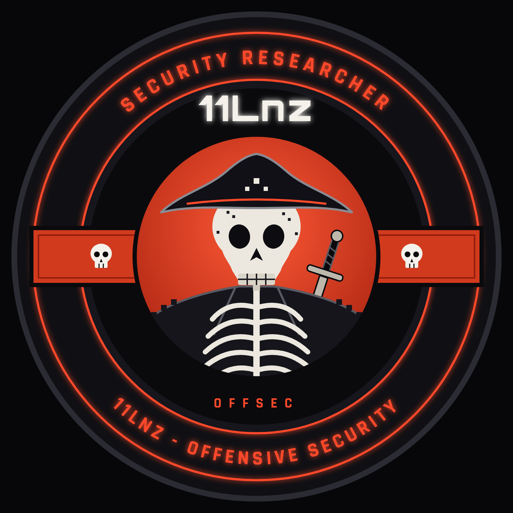

<div align="center">

<!-- LOGO: hospedada no repo Enzofmlg/portifolio (pasta assets). Se o nome do arquivo mudar, ajuste so o final da URL (espaco = %20) -->


<br>


<br>

<!-- ID CARD -->


<br><br>

<a href="https://www.linkedin.com/in/enzo-frederico-lenzi-b838a5272/"></a>
<a href="https://www.youtube.com/@zeno-zz"></a>
<a href="https://github.com/Enzofmlg"></a>

</div>

<br>


<h3 align="center"><code>[ 01 // WHOAMI ]</code></h3>

<!-- EDIT: ajuste o texto conforme quiser -->
```console
root@11lnz:~# whoami
Enzo Lenzi aka 11Lnz

root@11lnz:~# cat role.txt
Offensive Security Engineer

root@11lnz:~# cat /etc/mindset
> Think like an attacker.
> Build like an engineer.
> Automate everything.
> Break it to make it stronger.

root@11lnz:~# ls ~/focus
offensive-security/  automation/  red-team-ops/  ai-security/  pentest/  network-enterprise/

root@11lnz:~# _
```

<br>

<!-- EDIT: adicione/remova ferramentas -->
<div align="center">


</div>

<br>

<h3 align="center"><code>[ 02 // DEVOPS &amp; AI SECURITY ]</code></h3>

<!-- EDIT: ajuste o texto e as ferramentas conforme o que voce realmente usa -->
```console
root@11lnz:~# cat ~/devsecops/README.md
> CI/CD, containers, IaC and cloud: build it, break it, harden it.

root@11lnz:~# cat ~/ai-security/README.md
> LLM red teaming: prompt injection, jailbreaks, data leakage.
> Agent and tool abuse, model supply chain, adversarial ML.
> Attack it before someone else does.

root@11lnz:~# _
```

<br>


<h3 align="center"><code>[ 03 // CONTACT ]</code></h3>

<div align="center">

<a href="https://www.linkedin.com/in/enzo-frederico-lenzi-b838a5272/"></a>
<a href="https://www.youtube.com/@zeno-zz"></a>

<br><br>


</div>


